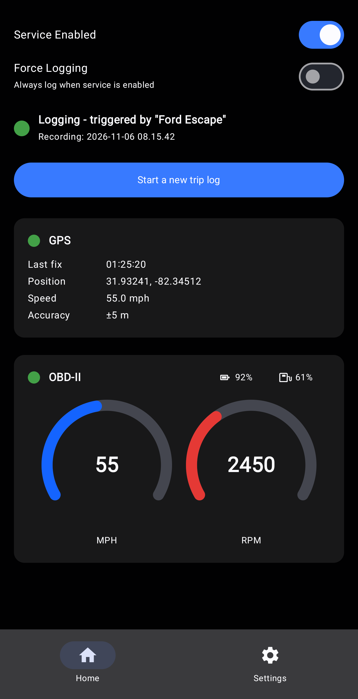

# Driving Trip Logger

Android app that records driving trips from GPS and the vehicle's OBD-II
port, and exports them as Google Earth and spreadsheet files.

## Features

- Connects to any ELM327-based Bluetooth OBD-II adapter
- Logs GPS position, altitude and speed alongside up to 34 selectable
  engine sensors (speed, RPM, coolant temperature, fuel level, battery
  voltage, and more)
- Trips start automatically when a paired Bluetooth device (e.g. the
  car's head unit) connects; manual and always-on modes are also
  available
- Live gauges for speed and RPM, with optional battery and fuel
  indicators
- Crash-safe journaling: trip data is written continuously, and any
  interrupted trip is completed on the next run
- Retention settings can purge or keep trips based on age and duration,
  and all output can be regenerated from the archived raw logs

## Output

- One KMZ per day containing a Google Earth track per trip, each with an
  embedded speed plot image (OBD vs. GPS)
- One OpenDocument spreadsheet per trip with the full data table
- Plot time axes follow the device's actual clock, marking time zone
  changes and date rollovers as they occur
- All values are exported in the selected unit system (US customary or
  metric)
- Files are written only to folders chosen in the app's settings

## Requirements

- Android 7.0 (API 24) or newer
- Bluetooth Classic (for the OBD-II adapter and trip-trigger devices)
- Location permission (GPS)

## Privacy

All data generated by the app remains on the device and is stored only
in the locations and manner specified by the user in the app's settings.
No user or diagnostic data is collected or distributed to third parties.

The optional "Look Up Placenames" setting sends trip start/end coordinates
to OpenStreetMap's Nominatim service to resolve placenames and the timezone
name; it can be switched off at any time in Settings → GPS. Trip details
link the endpoints to the OpenStreetMap website for convenience, and
coordinates go there only when the user taps those links.

## License

Released under the GNU Affero General Public License v3.0 only
(AGPL-3.0-only). See [LICENSE](LICENSE).

## Releases

A prebuilt, self-signed release APK is published on the
[`releases`](https://github.com/darkforcesjedi/triplogger/tree/releases)
branch of this repository
(e.g. `DrivingTripLogger-v1.2.apk`, with `SHA256SUMS.txt`).
Direct download for signed-in users:
`https://github.com/darkforcesjedi/triplogger/raw/releases/DrivingTripLogger-v1.2.apk`
Installing this APK side by side with a debug build is not possible:
uninstall the debug build first (different signing keys). Building it
yourself with your own key is always supported; see
[BUILDING.md](BUILDING.md).

## Building

See [BUILDING.md](BUILDING.md).
